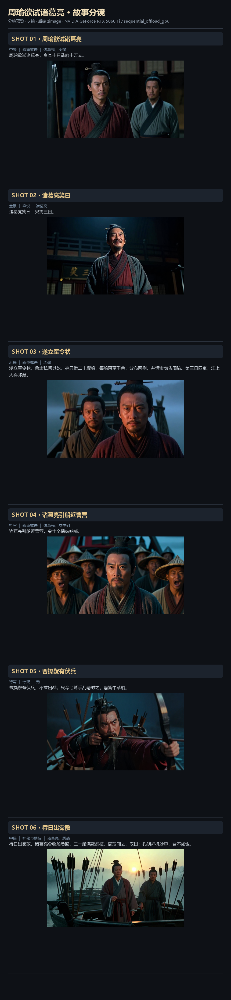

# StoryBoard Agent · 多智能体故事分镜生成系统

把任意故事文本自动变成一套可审阅的分镜：

```text
故事文本 → 结构化剧本/角色/风格 → 分镜表 → 逐镜出图 → 指标+VLM 验收 → 跨镜一致性检查 → 分镜册
```

两个关键可选项：

- **分镜来源**：`rule`（默认，零依赖文本规则）/ `llm`（部署 OpenAI 兼容服务后启用）
- **出图后端**：`mock`（纯 PIL，最小本地可跑）/ `zimage`（本地 GPU 真实出图）/ `cloud`（云侧图像接口）

项目位置：`E:/PyProj/t2i-story-agent`

---

## 效果展示

《草船借箭》分镜预览长图（每镜按"描述 + 画面 + 标题"排列，来自真实运行结果）：



> 完整产物见 `output/caochuan_20261118_222916/`（该目录不入库，图片已另存到 `assets/` 供展示）。

---

## 1. 最小可运行：rule + mock

这条路径**不需要 GPU、不需要模型权重、不需要 LLM、不需要网络**，只需要 Python + `numpy` + `Pillow`。

```bash
# 在项目目录执行
python -m pip install -r requirements.txt

# 用内置示例故事
python main.py --story chensheng --script-mode rule --backend mock --shots 4 --size 512x288

# 用任意指定文本文件（相对/绝对路径都可以）
python main.py --story D:/stories/my_story.txt --script-mode rule --backend mock
```

Windows 可直接双击 `run.bat`，或：

```bat
set PY=E:\Anaconda\envs\showo2\python.exe
%PY% main.py --story D:\stories\my_story.txt --script-mode rule --backend mock --shots 4
```

运行结束后在 `output/<故事名>_<时间>/` 得到：

| 文件 | 内容 |
|---|---|
| `shots/*.png` | 逐镜画面 |
| `char_ref.png` | 角色外观参考/降级色卡 |
| `contact_sheet.png` | 分镜总览网格图 |
| `preview.png` | **预览长图**：按顺序列出每镜的“描述 + 分镜图 + 标题” |
| `storyboard.html` | 分镜册，含完整 prompt、指标和输入故事全文 |
| `storyboard.json` | 共享黑板快照，可复现/审计 |
| `report.md` | 运行报告 |
| `run.log` | 控制台日志 |

> `--shots` 会被限制在 **4–8 镜**；故事文本太短时解析器会自动按句补足节拍。

---

## 2. 项目流程

```text
                         ┌──────────── Blackboard 共享黑板 ────────────┐
                         │ characters / scenes / beats / shots / reviews │
                         └──────────────────────────────────────────────┘

  [输入]  .txt 故事文件或 stories/ 下的内置故事名
      │
      ▼
  STAGE 1  预处理
      ScriptAgent    → script_parser(rule | llm) → 角色/场景/情绪/全局风格
      StoryboardAgent → 按叙事节拍拆 4–8 镜，定景别/构图/光线/运镜/seed
      │
      ▼
  STAGE 2  生成
      RenderAgent    → 按分镜拼英文 prompt，复用角色外观 token
      Backend        → mock（PIL） / zimage（GPU） / cloud（HTTP）
      │
      ▼
  STAGE 3  评估
      ReviewerAgent   → CLIPScore + 一致性 + 审美 + VLM 检查，必要时局部修复/重画
      ConsistencyAgent → 角色 token 复用率、风格串一致率、跨镜色彩一致性
      │
      ▼
  [输出]  shots / preview / contact_sheet / storyboard.html / report.md
```

五个 Agent 只通过黑板交换状态；黑板最后落盘为 `storyboard.json`。任何阶段都能从日志和 JSON 回溯。

---

## 3. 实现原理

### 3.1 共享黑板（Blackboard）

`story_agent/blackboard.py` 定义 `Character / Scene / Beat / Shot` 等数据结构。ScriptAgent 写入角色、场景、节拍和风格串；StoryboardAgent 写入分镜；RenderAgent 写入图片路径、prompt 和 seed；ReviewerAgent 写入验收结果。这样替换任意故事时不需要改 Agent 代码。

### 3.2 分镜来源一：rule 规则版（默认）

`story_agent/script_parser.py` 的 `parse_rule()` 从**输入文本本身**推导：

- **角色**：中文单姓/复姓识别 + 说话人加权 + 别名归一；群体角色识别“戍卒/将士/众人/军官”等；
- **外观**：按角色上下文命中“农夫/士兵/将军/女子/老者”等线索合成稳定英文 token，并按名字哈希固定配色；
- **场景/情绪/标题**：地点、时间、天气、情绪词表动态命中；标题取台词或首句；
- **时代风格**：识别秦/三国/汉/唐/宋/明/清等词生成全局风格串，未识别则不套朝代；
- **节拍与镜头语言**：按段落/句子切 4–8 拍；景别（特写/近景/中景/全景/远景）、构图、光线、运镜由每拍关键词动态选择。

旧版把陈胜专用的角色表和 8 镜方案写成常量，换故事就失效；现在这些常量已全部移除。已用《陈胜起义》《草船借箭》《火烧连营》三个不同故事验证同一条流水线。

### 3.3 分镜来源二：LLM 结构化抽取（可选）

部署任意 OpenAI 兼容 `/chat/completions` 服务后：

```bash
set SB_LLM_BASE=https://your-endpoint/v1
set SB_LLM_KEY=sk-xxxx
set SB_LLM_MODEL=qwen-plus
python main.py --story D:/stories/my_story.txt --script-mode llm --backend mock
```

LLM 按固定 JSON schema 输出 `title / global_style / characters / beats`，人物外观和分镜通常更准。调用失败会自动回退到 rule 并在黑板里记录原因，不会中断流程。`--script-mode auto` 表示有 `SB_LLM_KEY` 或 `SB_LLM_BASE` 时先试 LLM，否则直接用 rule。

### 3.4 出图后端

| 后端 | 命令值 | 特点 |
|---|---|---|
| 本地渲染 | `--backend mock` | 纯 PIL 电影概念图，0 依赖，保证流程完整可跑 |
| Z-Image | `--backend zimage` | `diffusers.ZImagePipeline`，真实本地 GPU 出图 |
| 云侧 | `--backend cloud` | OpenAI 兼容 images 接口，需配置环境变量 |
| 自动 | `--backend auto` | Z-Image → 云侧 → mock 依次降级 |

### 3.5 验收与修复

`story_agent/metrics.py` 计算四类分数：

- **CLIPScore**：默认用视觉线索色调匹配 + prompt token 覆盖的 `proxy` 实现；`SB_REAL_CLIP=1` 时加载真实 CLIP 权重；
- **角色一致性**：角色参考图 vs 镜头图的颜色/结构代理；可替换真实 DINOv2；
- **审美分**：曝光、对比、熵、锐度、色彩层数的像素统计启发式；
- **VLM 检查**：配置 `SB_VLM_ENDPOINT/KEY` 后调多模态模型；否则用规则式情节/构图/崩坏检查。

不达标时：曝光/对比/锐度类问题做局部修复；情节不符或崩坏则换 seed 重画，单镜最多 `max_repair=2` 次。所有分数来自真实图像统计；`proxy` 只表示未加载深度模型权重，不是写死的 1.0。

### 3.6 分镜册与预览长图

`ConsistencyAgent` 在最后生成 `contact_sheet.png`（网格总览）和 `preview.png`（长图）。预览长图按镜号依次绘制：标题条 → 景别/情绪/角色标签 → 画面描述 → 对应分镜图，适合直接横向滚动审阅。

---

## 4. 完整执行方法

### 4.1 命令参数

| 参数 | 说明 |
|---|---|
| `--story NAME\|路径.txt` | `stories/` 下故事名（不含扩展名），或任意 `.txt` 路径 |
| `--script-mode rule\|llm\|auto` | 分镜/剧本来源，默认 `rule` |
| `--backend auto\|zimage\|mock\|cloud` | 出图后端，默认 `auto`；最小运行用 `mock` |
| `--mode auto\|offload\|sequential\|full_gpu\|cpu\|manual` | Z-Image 显存策略 |
| `--shots 4..8` | 分镜数，默认 8，实际会限制到 4–8 |
| `--size 宽x高` | 分辨率，默认 1024x576；16:9 且建议 16 的倍数 |
| `--steps N` | 推理步数，Turbo 推荐 9 |
| `--no-ref` | 跳过角色参考图，少一次模型调用 |

### 4.2 故事输入

内置故事在 `stories/`：`chensheng.txt`、`caochuan.txt`、`huoshao.txt`。

```bash
# 内置故事名
python main.py --story huoshao --backend mock --shots 7

# 指定文本文件（绝对路径也可用）
python main.py --story E:/PyProj/t2i-story-agent/stories/caochuan.txt --backend mock
```

输出目录只取文件名 stem 做前缀，因此绝对路径不会生成非法目录名。

### 4.3 真实 Z-Image（RTX 5060 Ti 16GB）

结论：**能跑 GPU，但必须先把权重转成 BF16，并用 sequential offload**。

```bash
set PY=E:\Anaconda\envs\showo2\python.exe

:: 1) 私有 vendor 注入 diffusers 0.36（不改动 conda 环境）
%PY% tools\bootstrap_diffusers.py

:: 2) 下载权重（HF 直连不可用时走 ModelScope CDN）
%PY% tools\fetch_model.py

:: 3) F32 → BF16：32.83 GB → 20.52 GB，加载 33s → 0.8s
%PY% tools\convert_bf16.py

:: 4) 先验 GPU
set SB_MODEL_DIR=E:\PyProj\t2i-story-agent\models\Z-Image-Turbo-bf16
%PY% tools\check_gpu.py --mode sequential --size 512x288

:: 5) 完整真实运行
%PY% main.py --story huoshao --backend zimage --mode sequential --shots 7 --size 512x288
```

> **常见错误**：只写 `--backend zimage` 而不设 `SB_MODEL_DIR` / `--mode sequential`，会默认加载 **F32 32.83GB 权重 + `cpu_offload`**，在首张图去噪时 native OOM/SIGSEGV（Python 栈里看不到）。现在启动阶段会直接拦下这个组合并打印修复提示。

16GB 卡不能用 `full_gpu`；`offload`/`manual` 会因 DiT 约 12.3GB 装不下而 OOM/SIGSEGV。`sequential` 逐子模块换入，实测峰值显存约 **0.78GB**，单张 512×288 / 9 步约 3–4 分钟。已有真实结果见 `output/huoshao_20261117_212428/`：7 镜真实出图，6 镜通过，SHOT 03 因代理一致性指标误判而 `give_up`。

### 4.4 云侧图像 / VLM

```bash
set SB_CLOUD_IMAGE_URL=https://your-endpoint/v1/images/generations
set SB_CLOUD_IMAGE_KEY=sk-xxxx
set SB_CLOUD_IMAGE_MODEL=z-image-turbo

set SB_VLM_ENDPOINT=https://your-endpoint/v1/chat/completions
set SB_VLM_API_KEY=sk-xxxx
set SB_VLM_MODEL=qwen-vl-max

python main.py --story chensheng --backend cloud --script-mode llm
```

---

## 5. 最小仓库与依赖

`.gitignore` 的目标是：**仓库只保留能读懂和能跑 `rule + mock` 的最小集合**，大体积和可重建资源不入库。

保留：

```text
main.py  config.py  story_agent/  stories/*.txt  tools/*.py
requirements.txt  README.md  .gitignore  run.bat
assets/preview_caochuan.png     # README 效果展示图
```

> 注意：虽然 `.gitignore` 忽略了整个 `output/`，但 `assets/` 不在忽略规则内，因此展示图可以正常入库。

忽略：

```text
models/ vendor/ output/ .cache/        # 权重、私有 diffusers、运行产物、下载缓存
.venv/ .venv-*/ venv/ env/             # 虚拟环境
__pycache__/ *.py[cod]                 # Python 缓存
.idea/ .vscode/ *.iml  *.log           # IDE 与日志
```

依赖分层：

- **最小必需**：`numpy`、`Pillow` —— 足够跑 `rule + mock`；
- **可选增强**：`opencv-python`（更好的图像统计，不装也有 numpy 回退）、`requests`（云侧接口/下载脚本）；
- **真实 Z-Image**：`torch>=2.7.0+cu128`、`diffusers==0.36.0`、`transformers>=4.57.6`、`accelerate>=1.0`、`safetensors>=0.4`。

`tools/bootstrap_diffusers.py` 会从镜像下载 4.6MB wheel 并解压到 `vendor/`；`config.py` 自动把 `vendor/` 插到 `sys.path` 最前，因此不需要修改 conda 环境。

---

## 6. 已知限制

- Z-Image-Turbo 是纯 T2I，没有原生 IP-Adapter；角色一致性靠“固化外观 token + 固定 seed + 参考图验收”，不是像素级身份锁定。
- 代理一致性指标可能把“参考板 vs 剧情画面”的构图差异误判为角色不一致；接入真实 DINOv2/VLM 可缓解。
- rule 版姓名抽取基于姓氏字典 + 词频，生僻复姓或只出现一次的角色可能漏抽；用 `--script-mode llm` 可提升准确率。
- prompt 以**中文情节为主体**（Z-Image 的 Qwen3 文本编码器支持中文），角色外观/镜头语言用英文作一致性锚点；真实 CLIPScore 对中文不友好，proxy 指标不受影响。
- 预览与 HTML 使用中文字体；字体缺失时自动回退到 PIL 默认字体，不影响生成流程。
